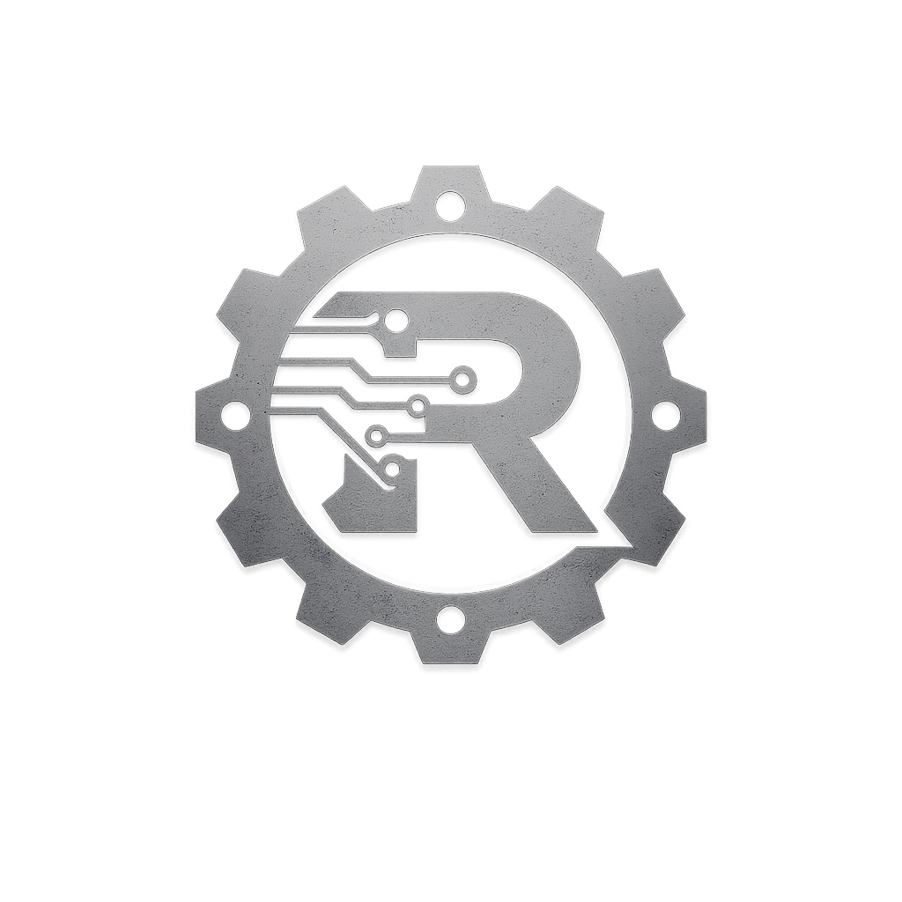

<p align="center">
  
</p>

# Rusty

Rusty is a small native programming language built around a strict separation of responsibilities: the deterministic compiler defines what a program means, while optional optimization backends may explore how that program is implemented. Generated implementations are never trusted merely because they compile; the reference backend remains the reliable path.

The language favors familiar, low-friction syntax—immutable `let` bindings, mutable `var` bindings, inferred local types, functions, conditions, and range loops—without requiring semicolons.

```rust
fn add(a: int, b: int) -> int {
    return a + b
}

fn main() {
    var score = 0
    for i in 1..5 {
        score += add(i, 1)
    }
    print("score", score)
}
```

## Compiler pipeline

```text
source → lexer → parser → name resolution → type checker
       → typed HIR → canonical RIR → LLVM IR → native executable
```

The current compiler includes source-located diagnostics, deterministic name and type resolution, byte-stable RIR serialization, guarded integer division, short-circuit logic, project discovery, native linking, and an explicit reference fallback when an unavailable optimization backend is requested.

## Build and run

Rusty requires Rust 1.93.1 and Clang 18 or newer. Set `CLANG` if Clang is not available on `PATH`.

```text
cargo build --release
cargo run -- check examples/hello
cargo run -- run examples/hello -O2
cargo run -- run examples/control -O3
cargo run -- test examples/control
```

Create a project with `cargo run -- new hello`. A project contains `Rusty.toml`, `src/main.ry`, and optional standalone `tests/*.ry` programs. Builds place canonical `.rir`, generated `.ll`, and the native executable in the project's ignored `build/` directory.

## Language contracts

- [Language semantics](docs/language-v0.md)
- [Grammar](docs/grammar-v0.md)
- [Canonical RIR](docs/rir-v0.md)
- [ABI and reference backend](docs/abi-v0.md)
- [Conformance policy](docs/conformance-v0.md)

## Development

```text
cargo fmt --all -- --check
cargo check --workspace --all-targets
cargo clippy --workspace --all-targets --all-features -- -D warnings
cargo test --workspace --all-targets
cargo build --workspace --all-targets --release
```

Rusty does not currently make a neural-performance claim. The `bench` command is a local reference-backend timing aid, not a substitute for a controlled benchmark study.